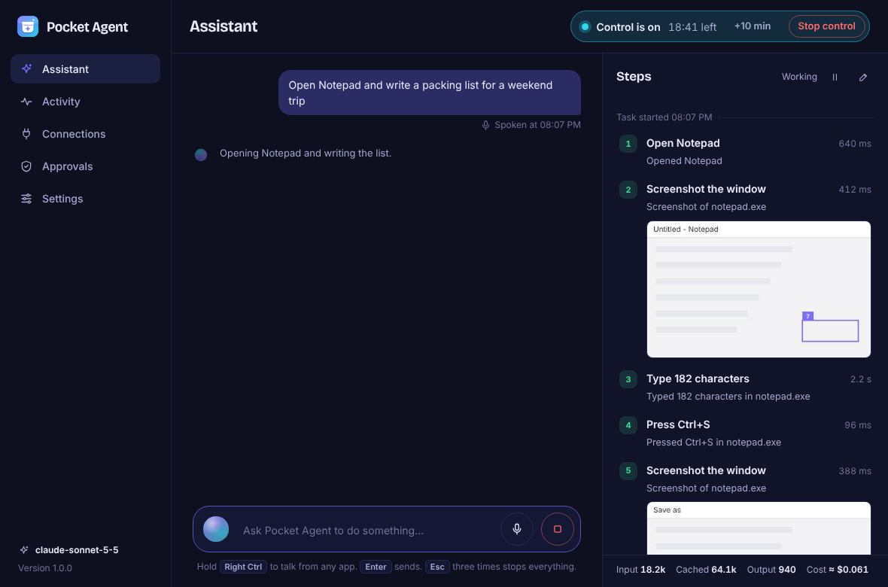
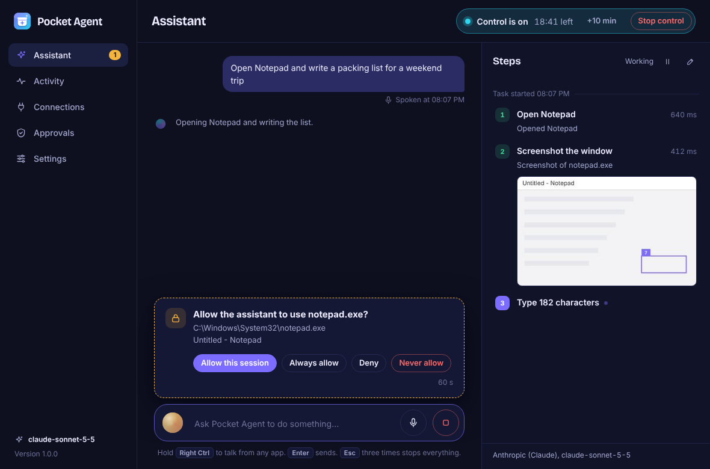

# Pocket Agent for Windows 1.0

Talk to an AI that works your Windows PC. Hold a key, say what you want ("open Notepad and write a packing list", "find the invoice email from Tuesday and save the PDF"), let go, and Pocket Agent does it in the apps on your screen while you watch each step. Talk again at any moment to interrupt or correct it.



It is also still the MCP bridge from 0.3: the same `windows_*` tools are served to other assistants (Cursor, VS Code, Claude Desktop, cloud assistants through a tunnel), with the same approvals and safety rules.

This version is a rebuild of the 0.3 Windows port. The Rust MCP engine (`rust-core`) is kept. Around it are a new WPF host with a WebView2 interface, a voice pipeline, a built-in agent that works with any model provider, and a floating voice bubble.

## What's new compared with 0.3

| Area | 0.3 | 1.0 |
| --- | --- | --- |
| Assistant | None. Needed an external MCP client | Built-in agent loop using your own API key. No step limit: it works until the task is done or you stop it |
| Voice | None | Push-to-talk from any app, optional "Hey Pocket" wake word, spoken replies, voice "stop / pause / continue" |
| Tools | 11 | 19: adds double/right click, hover, real key chords, open websites, list and switch windows, OCR, and numbered marks on screenshots |
| Safety | App approvals | Adds a never-allow list, confirmation before send/delete/pay steps, instant takeover, triple-Esc panic stop and a click preview |
| Interface | WinForms panel | WebView2 interface: live step timeline with token and cost meter, approvals manager, first-run setup, light and dark themes, tray icon |
| Remote use | Bring your own tunnel | Optional one-click Cloudflare quick tunnel, or your own HTTPS URL |
| Keys and secrets | A new MCP secret each session, kept in memory | API keys encrypted with Windows DPAPI. The MCP secret is new each session, or kept between sessions (also encrypted) if you choose |

## Talking to it

- **Push-to-talk.** Hold **Right Ctrl** on its own while you speak, then release. Using Right Ctrl in a quick shortcut or a Ctrl+click doesn't trigger it. Other keys can be chosen in Settings → Voice: Ctrl+Space, Ctrl+Shift+Space, Ctrl+Alt+Space, F8, F9 or Pause, either *hold to talk* or *tap on, tap off*. The microphone button and the tray menu work too.
- **Interrupt anytime.** Talking while it works pauses the task and stops it speaking. What you say becomes a correction ("no, the other file") or a new instruction.
- **Voice commands.** While a task runs, hold the talk key and say "stop", "pause" or "continue" (German: "stopp", "warte", "weiter"). With voice commands on, "Pocket, stop", "Pocket, pause" and "Pocket, continue" also work hands-free.
- **Wake word (optional, off by default).** "Hey Pocket" starts listening without a key. It runs offline in the Windows speech engine and only these few phrases can be recognised.
- **Speech to text.** You can use either of two options:
  - Windows dictation is free. It needs *Settings → Privacy & security → Speech → Online speech recognition* turned on.
  - Any Whisper-compatible service: OpenAI by default, reusing the provider key, or a URL of your own.
- **Its voice.** Windows voices work offline, and a German voice is picked automatically for German replies when one is installed. OpenAI voices are also available, or speech can be turned off. It narrates steps briefly and reads replies aloud; each can be switched off.
- **The bubble.** A small floating pill shows what it heard, what it's doing and any approval questions. It never takes focus from the app you're in and is hidden from screenshots, so the model never sees or clicks it. Drag it anywhere, or set it to show only while active or never.

## What it can do on your PC

| Tool | Action |
| --- | --- |
| `windows_status` | Foreground app, lock state, monitors with position and scaling |
| `windows_get_screen` | Numbered UI Automation elements with bounds and field values. Password fields are redacted |
| `windows_screenshot` | JPEG of the window or the whole desktop, optionally with numbered boxes on clickable elements |
| `windows_read_text` | Windows OCR with screen coordinates, for apps without accessible controls |
| `windows_tap`, `windows_double_click`, `windows_right_click`, `windows_long_press`, `windows_hover` | Pointer actions by element number or by coordinates |
| `windows_type` | Unicode text into a verified text field; refuses password fields. Newlines are typed as Shift+Enter |
| `windows_key` | Key chords such as `ctrl+s`, `alt+f4` or `f5`, repeatable. Shortcuts like Win+R, Win+X, Win+L, Ctrl+Alt+Del and Ctrl+Shift+Esc are blocked |
| `windows_scroll`, `windows_swipe` | Wheel scrolling and dragging |
| `windows_press` | Back, show desktop, task view, notifications, quick settings |
| `windows_open_app` | An installed app by its Start-menu name, including Store apps. Never a path or a command |
| `windows_open_url` | An http/https address in the default browser |
| `windows_list_windows`, `windows_focus_window` | List open windows and switch between them |
| `windows_wait` | Wait for the screen to settle |

## Safety

- **Per-app approval.** The first time it reads or controls an app, it asks: *Allow this session*, *Always allow*, *Deny* or *Never allow*. The Approvals page lists everything and lets you revoke it. The never-allow list starts with common password managers. *Always allow* uses the same `approvals.json` format as 0.3, so old approvals carry over.
- **Confirmation for risky steps.** Before it clicks something like *Send*, *Delete*, *Pay*, *Buy*, *Submit* or *Post*, it waits for your OK. The same applies to their German equivalents, to Ctrl+Enter, to Enter in chat and mail apps, and to Delete in File Explorer. The phrase list can be edited in Settings.
- **You can always take over.** Moving the mouse, clicking or typing pauses it immediately, and pressing **Esc three times** stops everything. Saying "stop" also works.
- **Click preview.** A ring shows exactly where it will click a moment before it clicks.
- **Auto-stop.** Desktop control switches itself off after 20 minutes. You can choose 10 minutes to 2 hours, or *until I stop it*.
- **Hard limits.** It refuses password fields, UAC and other secure desktops, the lock screen, and its own windows. It never runs commands or arbitrary programs. Typed text is never written to the log.
- **MCP server.** Listens on `127.0.0.1` only. Every request needs a 256-bit secret, either in the URL or as a `Bearer` token. Requests from browsers (with an `Origin` header) are rejected.
- **Keys.** API keys, and the MCP secret if you keep it between sessions, are encrypted with Windows DPAPI for your user account.

Model instructions are not a security boundary, and apps can expose misleading accessibility data. Supervise it on accounts that matter. Elevated (administrator) apps may refuse automation.



## Model providers

Choose a provider in the setup wizard or in Settings → Assistant, paste a key, then press **Test**.

| Provider | Default model |
| --- | --- |
| Anthropic | `claude-sonnet-5-5` |
| OpenAI | `gpt-6.1-terra` |
| Google Gemini | `gemini-3.8-flash` |
| OpenRouter, Groq, Mistral, xAI | Pick a model from the provider's list (**Load models**) |
| Ollama or LM Studio on this PC | No key needed |
| Custom | Any OpenAI-compatible endpoint |

Model names and prices were taken from the providers' pages in November 2026. **Load models** fetches the current list. The cost meter uses the known prices, or the prices you enter.

## Connect other assistants (MCP)

Start desktop control, then open **Connections**:

- **On the same PC:** copy the URL (`http://127.0.0.1:8765/k/<secret>/mcp`) or a ready-made config for Cursor, VS Code or Claude Desktop. Claude Desktop connects through `npx -y mcp-remote`, so it needs Node.js.
- **From the cloud:** turn on the tunnel. The Cloudflare quick tunnel needs no account; use **Download cloudflared** once if it isn't installed. You can also enter the address of an HTTPS tunnel you run yourself.

Anyone who has the full address can use the apps you approved while control is on. Keep the address private and rotate the secret whenever you like.

Quick test from PowerShell on the same PC:

```powershell
$url = 'http://127.0.0.1:8765/k/YOUR_SECRET/mcp'
Invoke-RestMethod -Uri $url -Method Post -ContentType 'application/json' -Body '{"jsonrpc":"2.0","id":1,"method":"tools/list"}'
```

## Get the app

### Option A: let GitHub build it (nothing to install)

1. Put this folder in a **private** GitHub repository, including the hidden `.github` folder.
2. Open **Actions → Build Pocket Agent for Windows → Run workflow**.
3. Download **PocketAgent-Windows-portable.zip** (unzip it and run `PocketAgent.Windows.exe`) or **PocketAgent-Setup.exe**.

### Option B: build on Windows

You need Windows 10/11 x64 and the [.NET 8 SDK](https://dotnet.microsoft.com/download/dotnet/8.0). You also need [Rust](https://rustup.rs/) with the MSVC toolchain, which requires the Visual Studio C++ Build Tools. Then, in PowerShell:

```powershell
.\build-windows.ps1              # tests, then dist\PocketAgent-Windows\ and the portable ZIP
.\build-windows.ps1 -Installer   # also dist\PocketAgent-Setup.exe (needs Inno Setup)
.\build-windows.ps1 -SkipTests
```

If PowerShell says running scripts is disabled, run `powershell -ExecutionPolicy Bypass -File .\build-windows.ps1` instead.

The build is self-contained, so the PC that runs it needs no .NET installation. Keep `pocket_agent_core.dll` next to the EXE.

To work in Visual Studio, open `PocketAgent.sln`. Build the Rust engine once first with `cargo build --release --manifest-path rust-core/Cargo.toml`, so its DLL is copied next to the debug build.

### On the PC that runs it

- Windows 10 version 1809 or later, or Windows 11, x64.
- The Microsoft Edge WebView2 Runtime. It's built into Windows 11 and updated Windows 10. If it's missing, the app shows a download link.
- Windows may show a SmartScreen warning because the build isn't code-signed. Only run builds from source you have reviewed.

## First run

A short setup wizard walks you through four steps:

1. Choose a provider and test the key. You can skip this step if you only want the MCP bridge.
2. Pick the talk key and a voice, and check the microphone.
3. Choose the auto-stop time.
4. Start.

Pocket Agent then lives in the tray and in the bubble. To try it, hold Right Ctrl and say *"Open Notepad and write a packing list for a weekend trip."*

Settings, approvals, the diagnostic log (`crash.log`) and the WebView2 profile are stored in `%LOCALAPPDATA%\PocketAgentWindows`. The uninstaller offers to delete them.

## Preview the interface in a browser

The interface can be viewed without Windows, using a simulated host. From the repository root:

```bash
python -m http.server 8000
```

Then open `http://localhost:8000/tools/ui-preview/dev.html?scenario=working`. The other scenarios are `empty`, `prompt`, `paused`, `listening`, `setup`, `light`, `connections` and `activity`.

## What has been tested

This was built in a Linux environment, so **the Windows app itself has not been run yet**. Here is what was checked:

| Checked | How |
| --- | --- |
| Rust engine | 13 unit tests pass. A Linux build of the library passes the .NET ABI smoke test (`src/CoreSmoke`) |
| Core library | 50 tests pass on .NET 8. They cover the agent loop and steering, the three provider formats against a local fake server, context pruning, voice-activity detection, voice commands, WAV handling, risk rules, key chords, approvals and settings. They also run the MCP server through the real Rust engine over HTTP, and the controller end to end (talk key, approvals, takeover, panic, auto-stop) on a simulated platform |
| Windows layer | Compiles without warnings against Microsoft's WPF, WinForms, UI Automation and System.Speech reference assemblies and NAudio 2.2.1. The WebView2 and WinRT (speech, OCR) calls were compiled against hand-written stand-ins of their APIs, so the first real Windows build is the final check for those parts |
| Interface | Every page and the setup wizard were rendered and clicked through in Chromium with the simulated host, in light and dark themes |

**Not yet verified on a real PC:** keyboard and mouse hooks, the bubble and the click ring, microphone and speech, WebView2 hosting, UI Automation, OCR and input injection. The GitHub workflow runs all the tests above on Windows and then builds the EXE. Try it first with low-stakes apps such as Notepad and File Explorer.

## Project layout

| Path | Contents |
| --- | --- |
| `rust-core/` | MCP JSON-RPC engine with a C ABI (`pocket_agent_core.dll`) |
| `src/PocketAgent.Core/` | Platform-neutral logic (agent loop, providers, voice pipeline, safety, settings, MCP server, tunnel, controller), testable on any OS |
| `src/PocketAgent.Windows/` | WPF host: WebView2 interface (`Ui/`), bubble and click ring, input hooks, Windows tools (UI Automation, SendInput, screenshots, OCR), audio and speech, tray, DPAPI |
| `src/CoreSmoke/` | ABI smoke test for the Rust DLL |
| `tests/PocketAgent.Core.Tests/` | Self-contained test runner: `dotnet run --project tests/PocketAgent.Core.Tests -c Release` |
| `tools/ui-preview/` | Browser preview of the interface with a simulated host |
| `docs/` | Screenshots of the interface (from the browser preview) |
| `installer/PocketAgent.iss` | Inno Setup script (per-user install, upgrades 0.3 in place) |
| `build-windows.ps1`, `.github/workflows/` | Local build script and the GitHub build |

## Notes

- **.NET version.** .NET 8 reaches end of support on November 10, 2026. The project targets .NET 8 because that is the version it was compile-checked against. To move to .NET 10, change `TargetFramework` to `net10.0` (and `net10.0-windows10.0.19041.0` for the app) in the four project files, and `dotnet-version` in the workflow. Then build and run the tests.
- **Fonts.** The display font is Bricolage Grotesque (SIL Open Font License, see `Ui/bricolage-OFL.txt`).
